# Large sources: bounded model context, deterministic reading, an analytical store

Status: accepted direction, 2026-10-09. Step 0 ships with this document; steps 1–4 are
planned.

## Problem

Buyers bring ERP exports and spreadsheets, and the product must reach ERP scale:
years of purchase-order lines, stock movements and MRP runs, up to about 10⁹ rows
for the largest tenant and billions across tenants. An `.xlsx` sheet holds at most
1,048,576 rows, so that scale arrives as ERP extracts (CSV), connectors and history
accumulated over time, not as one workbook.

Today the model reads the data itself, row by row (main at `a8f0184`):

- `purchasing/sources/mapping.py` sends each table's raw rows to the source mapper in
  pages of 60 rows, with at most 100 pages per assessment across all tables: about
  6,000 rows, fewer for wide rows, while the readers accept 20,000 rows per sheet.
  Past the budget the assessment has no records and a `source_limit` blocker.
- Cost and time grow with every row. An estimated $0.03–0.08 per page on the mapper
  model is $0.5–1.3k per million rows per pass, and one 1M-row table is about 16,700
  sequential calls. Mapping runs inside the HTTP/SSE request, without checkpoints.
- Report packs (#94) already read known SAP reports by code, without a model call.
  Every other layout still goes through row paging.
- The copilot read the whole `SourceAssessment` (106–156 KB for the 6–14 lines of the
  eval cases, mostly cell references), and its history replays tool results for ten
  turns. Stateless agents' inputs (spreadsheet pages, supplier emails) were copied
  into Agno's tables, which have no row-level security. Step 0 fixes both.

## What the research says

Academic results, vendors and competitors converge on one shape: the model decides
what the data means from a small, structured view of it; code reads, transforms,
computes and verifies every row.

| Finding | Evidence |
|---|---|
| Rows in a prompt degrade early, far below the context limit | GPT-4o falls from 56% to 31% on tables past 20K tokens ([RealHiTBench](https://arxiv.org/abs/2506.13405)); reading a whole table fails at 100×100 cells ([TableRAG](https://arxiv.org/abs/2410.04739)); the serialization alone moves scores by up to 0.22 ([ToRR](https://arxiv.org/abs/2502.19412)) |
| Synthesizing a program once and running it over all rows works, with validation | [Evaporate](https://arxiv.org/abs/2304.09433): 110× fewer tokens and +10 F1 against per-document extraction, but only with several candidates and checks; one synthesized function alone was 14 F1 worse. [Auto-Tables](https://arxiv.org/abs/2307.14565) reshapes over 70% of real non-relational tables with eight operators; [SpreadsheetLLM](https://arxiv.org/abs/2407.09025) compresses sheets 25× through structural anchors |
| Model-written SQL over raw enterprise schemas is not production-grade | 0–4% on real warehouses ([BEAVER](https://arxiv.org/abs/2409.02038)), 21% on [Spider 2.0](https://arxiv.org/abs/2411.07763) |
| A typed query compiled by code wins where it applies, and fails loudly | 98–100% vs 84–90% for text-to-SQL ([dbt, 2026](https://docs.getdbt.com/blog/semantic-layer-vs-text-to-sql-2026)); "failure looks like an error message", not a plausible wrong number |
| Per-row judgments go through cascades over distinct values | Cascades with accuracy guarantees save up to 86% more than earlier methods ([BARGAIN](https://arxiv.org/abs/2509.02896)); semantic joins with up to 1,000× fewer model calls ([LOTUS](https://arxiv.org/abs/2407.11418)) |
| Vendors keep rows out of the model | Oracle Select AI sends "schema metadata only"; Microsoft's Fabric data agent returns at most 25×25 cells; SAP calls Joule's skills "deterministic actions"; import tools (OneSchema, Dromo, Flatfile, Osmos) map from headers and samples and run every row in an engine, remembering the mapping per layout |
| Competitors keep what commits in code | Keelvar and Archlet award with solvers, Pactum's "rule-based AI calculates offers" inside a contract space, planning tools (Anaplan, Pigment, Lokad) compute in their engines; messy-data onboarding is still done by people (forward-deployed engineers) |

## Decisions

1. **Region: `us-east-2`.** The analytical store and ingestion run next to RDS and the
   documents bucket, inside the organization's region lock. Nothing requires in-country
   processing in Brazil today; if a customer does, that moves the whole stack, not one
   store.
2. **Analytical store: per-tenant Parquet in S3, read by DuckDB inside a dedicated
   ingestion task.** No new vendor. Isolation fails closed at three layers:
   - Keys live under the tenant's prefix and are encrypted with SSE-KMS, as documents'
     are, plus the encryption context of `{tenant_id}` the infrastructure design asks
     for (documents do not set it yet).
   - Each job reads with STS credentials whose session policy is limited to that prefix;
     the worker's own role cannot read the store.
   - A manifest table in Postgres with forced RLS lists every file; a job reads only the
     files its tenant's manifest lists.

   No tenant means no credentials. AGENTS.md gets this rule with the store. If the store
   outgrows one task (p95 tool latency over 3 s after pruning and rollups, a tenant over
   about 100 GB, or more than 20–50 heavy concurrent queries), the next engine is
   **Redshift Serverless** in `us-east-2`: AWS-native, its row-level security denies by
   default and reads the tenant from `set_config(…, true)` as our Postgres does.
   MotherDuck or ClickHouse Cloud only after a subprocessor review ("documents stay in
   AWS, no second cloud by default").
3. **Targets.** Design for 10⁹ history rows for the largest tenant. A copilot data tool
   answers within 3 s at p95. Ingestion is asynchronous and reads at least 1M rows a
   minute per task. The model reads at most about 15K tokens per table whatever its rows,
   and spends at most $0.10 per new layout and nothing for a known one. Ingestion runs on
   its own task size (2 vCPU / 8 GB to start, scaled on its own queue): the worker has
   1 GB, and a 1M × 60 workbook can need several GB to parse.
4. **ERPs: SAP first, files first.** Report packs read SAP list exports today. ERP
   exports are first-class sources (upload now, an email or S3 drop later). Inbound NF-e
   XMLs are the first ERP-independent source: a national schema, read entirely by code.
   A TOTVS pack follows when a customer brings its exports. Live connectors are built
   for a paying customer: SAP S/4HANA through OData/CDS or Datasphere, never through ODP
   RFC (SAP Note 3255746 blocks third-party calls); Brazilian SaaS ERPs (Omie, Sankhya,
   Bling) as `dlt` sources in the worker.
5. **No execution of model-written SQL or code.** The model emits typed plans and specs;
   code validates and executes them. Reviewed, versioned code in a sandbox stays possible
   for a layout no spec can express, never as a live agent tool.

## Principles

1. **The model reads a bounded view of a table, never the table.** Structure, column
   profiles computed over every row, distinct values and a sample that code chose. Cost
   follows layouts, columns and distinct values, not rows.
2. **The model emits typed plans, never values, SQL or code.** Code validates a plan
   against the data before running it on every row, and copies values with their
   provenance, as the mapper's locators do today.
3. **Per-row meaning is decided per distinct value and cached per tenant.** Deterministic
   keys first (part codes, CNPJ root, NCM), then rules, similarity, a small model, the
   mapper model, and a person for what stays doubtful.
4. **Reconcile and fail closed.** Rows in equal rows mapped plus rows rejected with a
   reason; a source's own total rows must tie; keys must be unique where the kind says
   so. A source is ready only when these hold, measured by the false-ready rate.
5. **Numbers come from tools.** The model never computes a quantity or a price; a number
   in an answer is one a tool returned.
6. **Tool results a model reads are bounded** (`Tool.model_view`): no cell references, a
   stated budget, what was left out counted. The buyer's screen keeps the whole output.
7. **Cells are untrusted.** Cell text, sheet names, comments and hidden content can
   carry instructions. The model that reads them has no tool that commits; invisible
   characters are stripped and hidden content is flagged.

## Architecture

```mermaid
flowchart LR
    A[Upload, email or ERP extract] --> B[S3 raw, content-addressed]
    B --> C[Streaming parse: raw grid with coordinates]
    C --> D{Known layout?}
    D -->|report pack or confirmed spec| F[Apply spec to every row]
    D -->|new| E[Dossier: anchors, profiles, distinct values, sample]
    E --> M[Mapper: typed MappingSpec]
    M --> V[Validate spec against the profile]
    V --> F
    F --> R[Reconcile: counts, totals, keys, sample QA]
    R --> P[Typed Parquet per tenant + manifest under RLS]
    P --> Q[Planning, netting, pricing in code]
    Q --> T[Copilot tools: compiled queries, bounded results]
```

- **Land.** The raw file goes to S3 under its tenant, named by its SHA-256 and written
  only if absent, so redelivered jobs are idempotent.
- **Parse.** In a memory-capped process: DuckDB `read_csv` with every column as text,
  types and dialect detected over the whole file and rejected lines kept apart (never
  logged); calamine (`fastexcel`) for workbooks, with openpyxl's read-only streaming for
  sheets over the memory budget. The result is the raw grid with its coordinates, as
  `EvidenceTable` keeps today.
- **Recognize.** Report packs first (built-in specs in code); then the tenant's confirmed
  layouts, by fingerprint (sheet and header tokens, column order and type signature);
  else the mapper.
- **Map a new layout.** The mapper receives a dossier, not rows:
  - structural anchors (titles, header bands, blank separators, total rows);
  - per-column profiles over every row, with the locale proofs of `formats.py`;
  - the distinct values of low-cardinality columns;
  - at most about 50 rows chosen by code: head, tail, random and outliers.

  It returns a `MappingSpec` made of:
  - table regions and header rows;
  - row classes (data, subtotal, section heading with fill-down);
  - reshape operations (unpivot dated buckets);
  - column to canonical field, with the echoed header, as today;
  - parse rules, value maps and report-level constants.

  It is the shape `ReportSpec` already gives the SAP pack, learned instead of written.
- **Apply.** The same reader applies a pack's spec and a learned one, row by row,
  copying each value with its `SourceRef` and its canonical reading.
- **Reconcile.** Counts, total rows, key uniqueness, join coverage, and a sample per rule
  (no error among 299 sampled rows bounds that rule's error rate below 1% with 95%
  confidence). Failures go back to the mapper as aggregated errors with a few examples,
  never as pages.
- **Confirm and remember.** The buyer confirms the first reading of a new layout from a
  preview and its statistics. The spec is stored per tenant and fingerprint with the
  model, prompt version and profile hash; the next export of that layout is read without
  a model call, and drift sends it back to the mapper.
- **Store and analyze.** Typed Parquet with exact decimals, partitioned by dataset and
  month under the tenant's prefix; planning, netting and pricing stay in code and move
  to SQL over Parquet as volumes grow.
- **Ask.** Copilot tools answer from the store: fixed tools for decision inputs
  (netting, comparison) and one typed metric query (metrics, dimensions, filters, time
  grain, limit) compiled by code to parameterized SQL. Results are bounded, with
  handles to the whole set for the screen.

## Steps

0. **Bounded model context** (done). `Tool.model_view` lets a tool bound what the model
   reads while events and artifacts keep the whole output. The copilot reads every tool
   without cell references and source assessments within a budget: on the eval corpus,
   14–24% of the full output, every line kept. Agents without history keep no Agno run
   storage.
1. **Mapper with specs.** Dossier, `MappingSpec`, the shared reader, reconciliation and
   the layout registry (RLS); a new mapper prompt version. Done when no rows are paged,
   the eval corpus passes at least as today, and a 100K-row sheet is mapped with one
   model call per table.
2. **Ingestion task and store.** S3 Parquet, manifest, STS credentials per job,
   asynchronous jobs with checkpoints instead of mapping inside the request
   (infrastructure in `bido-infra`). Done when a 10M-row CSV lands in under 10 minutes on
   2 vCPU / 8 GB and cross-tenant reads are refused by S3 and by the engine.
3. **Query layer.** The metric query and fixed tools over the store, with a check that
   every number in an answer came from a tool. Done at p95 ≤ 3 s on a 10⁸-row tenant.
4. **Sources and scale.** NF-e XMLs, a TOTVS pack, connectors on demand, and the next
   engine when its triggers fire.

## Evaluation

- The corpus grows with large and wide sheets (100K+ rows, 60+ columns), the five
  languages, the same layout exported twice with drift, and metamorphic variants: rows
  shuffled, columns reordered, headers in another language, injected and hidden cells.
- Measured: false-ready rate first, then per-column mapping accuracy, value-map accuracy,
  reconciliation pass rate, evidence fidelity, model calls and tokens per table, time.
- Synthetic data only; no customer file enters an eval.

## Cost

| Approach | 10⁹ rows, one pass (estimate) |
|---|---|
| Row paging as built | $0.5–1.3M |
| A lean per-row prompt on the mapper model | $80–185K ($40–92K in batch) |
| Profiles and specs (10K layouts, 5M distinct values) | about $0.5–1.5K |

## Open items

- How many real layouts the reshape operations cover, and how stable fingerprints stay
  across ERP versions: measure on the first customers' exports.
- Hidden sheets and rows: read and flag, or skip and flag.
- The NF-e source: certificate handling if it ever pulls from SEFAZ instead of uploads.
- Embeddings for the similarity step: provider and storage (pgvector under RLS).
